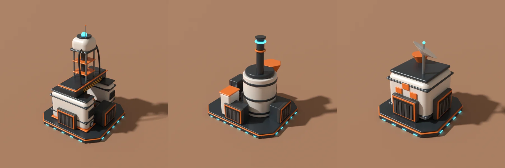

<pre align="center">
 __  __                  ____
|  \/  | __ _ _ __ ___  / ___|_      _____  ___ _ __   ___ _ __ ___
| |\/| |/ _` | '__/ __| \___ \ \ /\ / / _ \/ _ \ '_ \ / _ \ '__/ __|
| |  | | (_| | |  \__ \  ___) \ V  V /  __/  __/ |_) |  __/ |  \__ \
|_|  |_|\__,_|_|  |___/ |____/ \_/\_/ \___|\___| .__/ \___|_|  |___/
                                               |_|
</pre>

<p align="center"><b>Same toothbrush, new planet. Mars for Moon Sweepers :3</b></p>

<p align="center">
<a href="https://github.com/Elchi-dev/MarsSweepers/actions/workflows/ci.yml"></a>
<a href="#status"></a>
<a href="https://dotnet.microsoft.com"></a>
<a href="LICENSE"></a>
<a href="https://github.com/Elchi-dev"></a>
</p>



---

## Overview

Moon Sweepers is a co-op game about cleaning the Moon. My friends and I
cleaned it. Then we wanted more, and there is a planet right next door that
is famous for being covered in dust.

Mars Sweepers adds Mars as its own world. When you start a new save slot
you pick Moon or Mars. Moon worlds stay exactly as the game made them; Mars
worlds get their own save folder, their own valley and landforms, red dust,
a thicker sky, dust storms that roll in as a wall, ore mines and machines.
Everything is built for co-op: the host runs Mars, the crew sees the same
planet.

Installing it is one `.exe`. No folders to copy, no antivirus dance.

---

## The trick

**Mars lives next to the game, never inside it.**

```
            the game                          Mars Sweepers
   +---------------------------+     +-------------------------------+
   | MoonSessions/slot-1 ...   |     | MarsSessions/slot-N/          |
   | its save files            |     |   the game's save files       |
   | building kinds 1 to 192   |     |   mars-structures.json        |
   +---------------------------+     |   mars-data.json              |
                                     |   marsmod-world.cfg           |
                                     +-------------------------------+
   At runtime: Mars machines are real game buildings (kinds 193+),
   placed with the game's own hammer. On save they step out of the
   game's file into ours, by name: marsmod.building.drill.
```

Everything follows from that:

- **Moon saves are never touched.** Mars worlds have their own folder.
- **A Mars save opens without the mod.** The game's file never holds a
  building it does not know.
- **The game does the hard parts.** Ghost, footprint checks, payment,
  refunds, moving and crew sync are the game's own; Mars adds rules on top
  (a drill only on a mine).
- **Names, not numbers.** Kinds are handed out at runtime; saves use string
  ids, so another mod can take kind 193 and nothing breaks.

---

## What is in it

| Part | What it does |
| --- | --- |
| **Moon or Mars** | The choice for every new save slot, "MARS" on Mars slots, a red loading planet, the Mars contract and intro, a narrator |
| **The planet** | Terrain profile 3: a home valley that keeps the spawn crater and a walkable rim, Mars landforms and colours |
| **The air** | A sky dome and fog shells, haze per world, Phobos, morning start |
| **Dust storms** | A schedule per world seed, a 75 second warning with a front you can see, wind, sound and an alarm. Walls and roofs keep them out |
| **Mines** | A home mine next to the base and 36 more from the seed, water ice near the poles. They never run out |
| **Machines** | Ore drill, smelter, crusher, fiber spinner, assembler, electrolyzer, fuel refinery, container port, market board, in the game's build menu with their own cards, made in Blender in the game's style |
| **Power** | Solar panels (weak in storms), batteries, fuel generators, light poles that carry power; grids form by themselves |
| **Shields** | A shield generator raises a dome when a storm comes; the covered ground is found by flood fill |
| **Dust tiers** | Sectors pay x1 to x4 of the normal bounty, more the further you go |
| **Aliens** | Three trader outposts per world, alien alloy for what the crew makes |
| **The ending** | The planet cannon fires at the Moon, with the game's own ending sequence |
| **Storage** | A Mars backpack per player and crew storage that can be sold |
| **Market** | Prices that move, booms and crashes, a ticker; selling a lot lowers your price |
| **Storm work** | Storms jam machines that stand outside; scrub them by hand. Light poles clear the air around them |
| **Co-op** | Its own Steam channel, per-world Mars data, the host decides, the crew follows |
| **Dev terminal** | Ctrl+Shift+K: storms, haze, time, teleport, fly, models, research, test money |
| **MarsSetup** | One `.exe` with a window: Install, Play. Testers start it with `--dev` for the guided test and the report |
| **MarsProbe** | Reads the game: types, scenes, definitions, call traces |

---

## A quick look

1. Run `MarsSetup.exe` and press **Install** (it finds the Steam game by
   itself). Once, it sends you to Nexus Mods for the patcher the game needs;
   the download is picked up by itself. Then press **Play**.
2. Start the game, pick an empty slot, choose **Mars**.
3. In the world: Ctrl+Shift+K opens the terminal, `help` lists the commands.
   `money` gives $10,000 for testing, `tp mine` takes you to the nearest mine.
4. Take out the build tool: machines are under Production, the container
   port and market board under Logistics, power and shields under Power.

Building from source: [CONTRIBUTING.md](CONTRIBUTING.md).

---

## Planned

Belts carrying Mars materials (any side of a machine is input or output,
the belt decides), a container port fed by belts, and a logic gate you set
up by looking at it.
[docs/ROADMAP.md](docs/ROADMAP.md)

---

## Non-goals

- **Not a Moon overhaul.** Moon worlds stay vanilla. Everything here is Mars
  only.
- **Not a mod loader.** It runs on BepInEx 6. A shared API for Moon Sweepers
  mods is its own project; the reusable parts here are kept separate so
  they can move there.
- **Not for other game versions by accident.** It is built against Moon
  Sweepers 1.0.5; a new game version means checking the hooks.

---

## Status

Alpha.

Played in the game: the Moon or Mars choice, Mars saves, terrain profile 3,
the air, storms (indoors and out), the map, the contract, the logo, the
poster, the terminal, the narrator, the drill model, on Windows with
BepInEx 6 be.791.

Built, not played yet: mines and machines (0.7.0), the machines in the
game's build tool with the save side file (0.8.0), storm jams, light poles
and the market (0.9.0), power, shields, the second chain, ice and fuel,
dust tiers, aliens, the ending and the setup window (0.10.0). Not tested at all: a
second player with machines, Linux under Wine or Proton.

---

## Docs

| Document | What |
| --- | --- |
| [docs/ARCHITECTURE.md](docs/ARCHITECTURE.md) | The parts, the frame loop, every file, what lands on disk |
| [docs/HOOKS.md](docs/HOOKS.md) | Every game method the mod patches and why, and the rules for hooks |
| [docs/DECISIONS.md](docs/DECISIONS.md) | Why game building kinds, why a save side file, why string ids |
| [docs/ROADMAP.md](docs/ROADMAP.md) | What comes next, in order |
| [CHANGELOG.md](CHANGELOG.md) | Releases |
| [CONTRIBUTING.md](CONTRIBUTING.md) | Building the mod, the installer and the models |
| [NOTICE](NOTICE) | Third-party work |

---

## License

MIT for the code, models and pictures made for this mod. See
[LICENSE](LICENSE); third-party parts (BepInEx, the poster, the narrator
voice) keep their own terms, listed in [NOTICE](NOTICE). Moon Sweepers is a
game by DragDrop Games; this mod is not affiliated with or endorsed by them.

**Made by Elchi**
